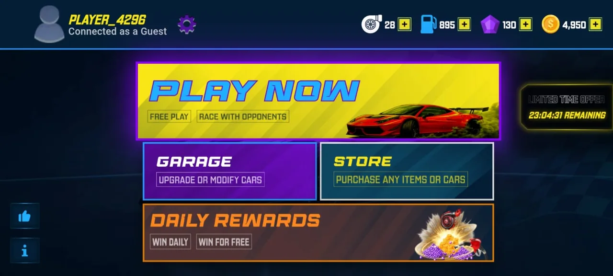
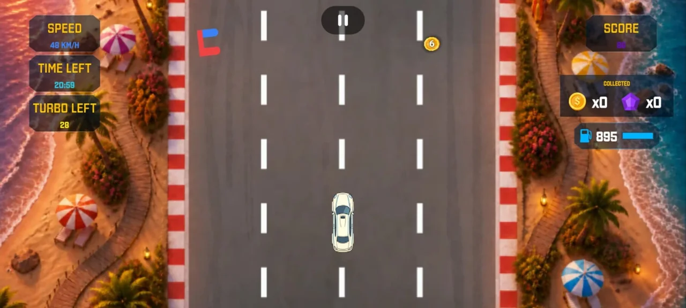
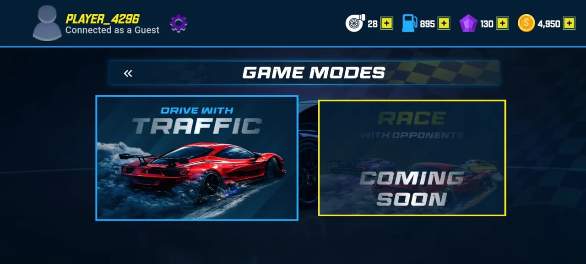
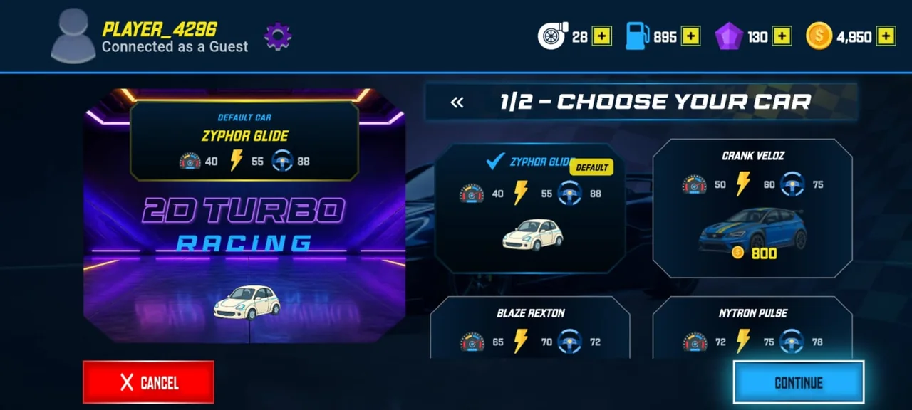
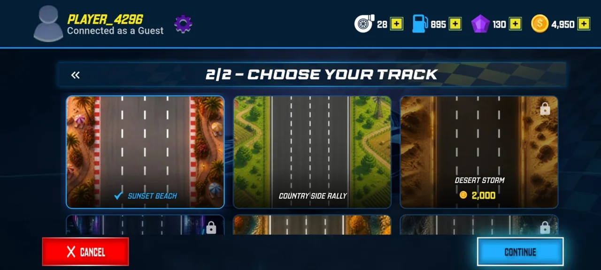
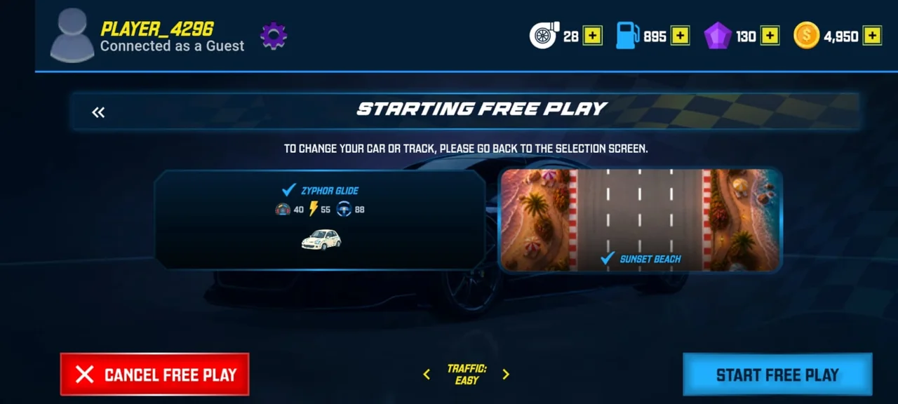
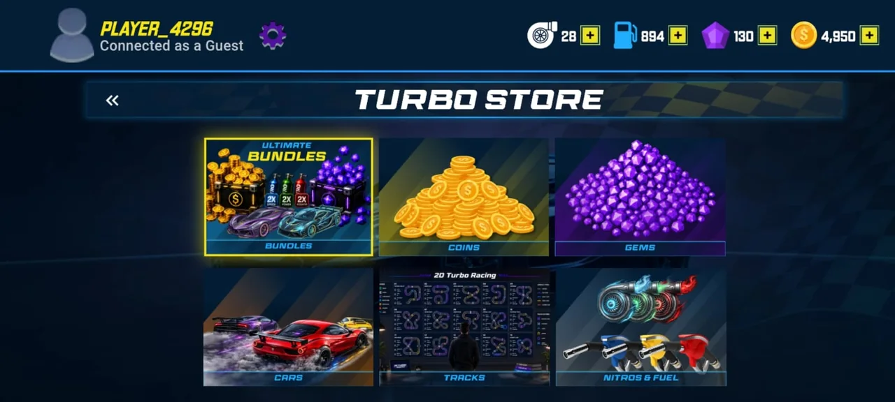
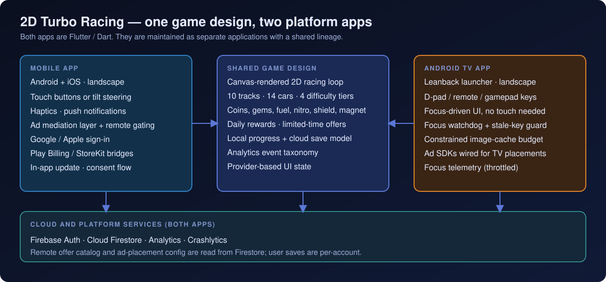
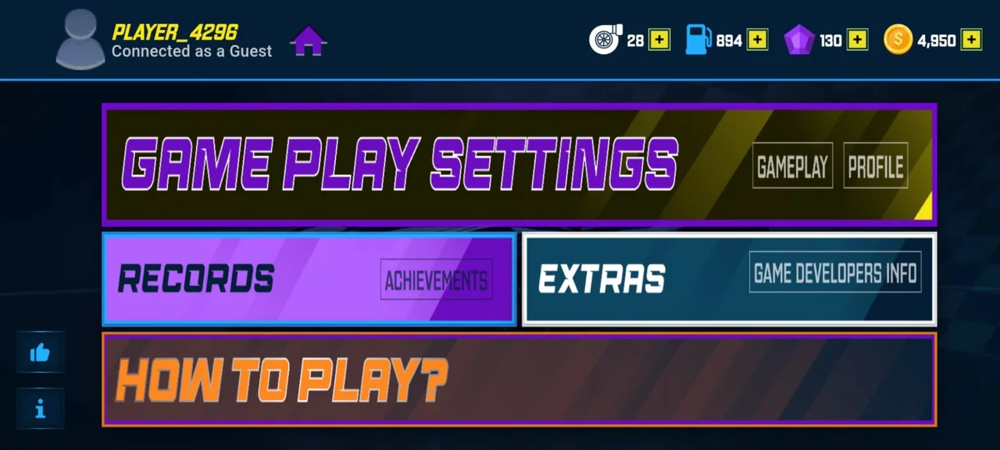
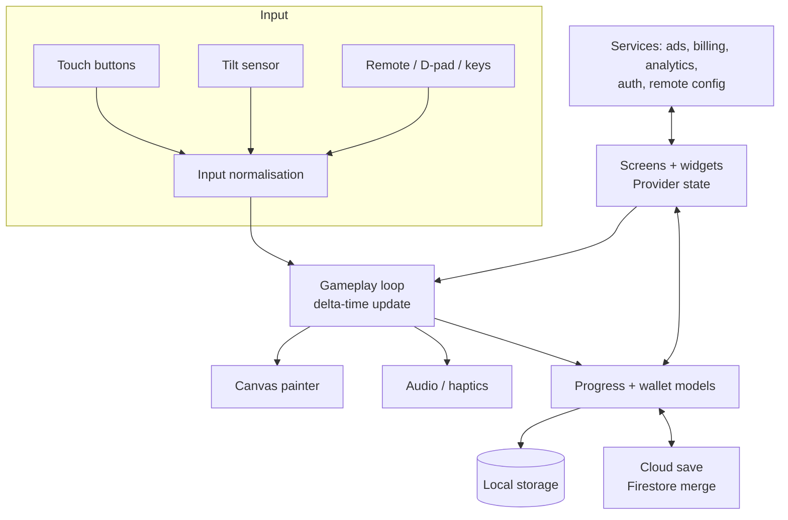

# 2D Turbo Racing

**A top-down 2D racing game with a garage, store and cloud-synced progress, engineered as two apps: a touch/tilt Mobile app and a remote-controlled Android TV app.**

**Mobile · Android TV** 
Flutter · Dart · Firebase · Custom Canvas Rendering (no game engine)

<table>
  <tr>
    <td></td>
    <td></td>
  </tr>
</table>
Real screenshots from the Mobile build.

---

## Get the Game

  
  

## Product at a Glance

| | |
|---|---|
| **What it is** | Landscape, lane-based arcade racing with 10 themed tracks, 14 cars and four difficulty tiers |
| **Meta-game** | Garage, coin/gem economy, fuel, power-ups, 7-day daily rewards, limited-time offers, records |
| **Platforms** | Mobile app (Android and iOS) and an Android TV app, built from one game design |
| **Rendering** | Hand-written `CustomPainter` canvas renderer with a delta-time loop; no game engine |
| **Services** | Firebase Auth, Firestore, Analytics, Crashlytics; native Play Billing (Kotlin) and StoreKit (Swift) bridges |
| **Code size** | About 55k lines of Dart in the Mobile app and 47k in the TV app (`lib/` only) |

## Live Product Showcase

<table>
  <tr>
    <td align="center"> <b>Game modes</b> Drive with Traffic; a second mode is marked coming soon</td>
    <td align="center"> <b>Car selection</b> Per-car stats, default car, coin prices</td>
    <td align="center"> <b>Track selection</b> Free and purchasable tracks</td>
  </tr>
  <tr>
    <td align="center"> <b>Free play setup</b> Traffic level selector</td>
    <td align="center"> <b>Turbo Store</b> Bundles, currencies, cars, tracks, boosters</td>
    <td align="center"> <b>Controls</b> Gyro (tilt) or on-screen buttons</td>
  </tr>
</table>

## One Game. Two Interaction Models.

The same racing product runs in two very different environments. Mobile is touch- and sensor-driven. Android TV has no touchscreen and is driven entirely by a remote, so focus handling and input reliability become first-order engineering concerns.

  

<table>
  <tr>
    <td width="50%" align="center"> <b>Mobile</b>: real build screenshot</td>
    <td width="50%" align="center"> <b>Android TV</b>: launcher banner artwork shipped with the TV app (artwork, not a screenshot)</td>
  </tr>
</table>

| | Mobile | Android TV |
|---|---|---|
| **Platform** | Android and iOS | Android TV (Leanback launcher, touchscreen optional) |
| **Primary input** | On-screen buttons or accelerometer tilt | Remote / D-pad / key events |
| **Navigation model** | Touch, with focus support retained | Focus traversal with explicit focus graphs |
| **Screen environment** | Handheld, landscape, either orientation | Living-room display, landscape |
| **Control architecture** | Pointer down/up/cancel; calibrated, smoothed tilt | Raw key events with stale-input release and focus watchdog |
| **UI considerations** | Scaled from a 1080p baseline with a minimum scale so phones stay legible | Scaled from a 1080p baseline; custom focus-state widgets, no touch ripples |
| **Performance** | Image-cache cap, trimming before heavy screens, R8, baseline profile | Same cache policy, justified in code by TV heap limits |
| **Platform services** | Push, in-app update, consent, Apple/Google sign-in, ad mediation | Google sign-in, Unity Ads and InMobi integrations |

Full comparison: [docs/MOBILE_VS_TV.md](docs/MOBILE_VS_TV.md).

## Engineering Highlights

### TV remotes lose key-up events
- **Problem:** a dropped key-up leaves the car steering in one direction forever.
- **Approach:** timestamped key state, auto-release timers plus a per-frame stale check, left/right mutual exclusion, and input accepted only while gameplay is active.
- **Outcome:** steering fails safe. If input goes quiet the car stops steering, and input recovers after dialogs or overlays steal focus (focus watchdog, back-navigation guard).

### Unknown ad configuration
- **Problem:** ad placements are controlled remotely, and showing ads on an unconfirmed config risks unintended placements.
- **Approach:** a single decision gate that fails closed until the remote config is confirmed, with background retry, per-zone request throttling, a per-race cap on rewarded ads and an audit trail.
- **Outcome:** no ad loads or shows on an unknown config, and the game loop has no direct dependency on ad SDKs.

### Mobile tilt steering across orientations
- **Problem:** raw accelerometer data is noisy, depends on how the player holds the phone, and flips sign when the device is rotated 180° between landscape orientations.
- **Approach:** detect the landscape flip and correct the sensor axis, calibrate the neutral point from an averaged sample, then smooth and apply a dead zone, scaled by a user sensitivity setting.
- **Outcome:** tilt direction stays correct in both landscape orientations, and the player's natural hold angle becomes neutral.

### More
| Area | What was built |
|---|---|
| **Rendering** | Single `CustomPainter` repainted from a lightweight notifier; sprites pre-decoded during a loading phase and disposed explicitly; delta-time loop with clamping; rectangle-overlap collision |
| **Persistence** | Local-first save with a schema-versioned Firestore document, merge and de-duplication, capped history, live listener with a write-echo guard |
| **Billing** | Kotlin Play Billing and Swift StoreKit managers behind platform channels, connectivity-aware initialisation |
| **Resources** | Capped image cache, trimming before heavy screens, race sprites loaded only for the selected car and track |
| **Release engineering** | R8 and resource shrinking, ABI filters, baseline-profile and macrobenchmark (startup, jank) modules |
| **Tests** | Ad-gate decisions, analytics validation, progress-save merge, TV focus telemetry throttling |

Details and trade-offs: [docs/ENGINEERING_CHALLENGES.md](docs/ENGINEERING_CHALLENGES.md).

## Architecture

More diagrams (input pipeline, Mobile, TV, shared vs platform-specific, sync): [docs/ARCHITECTURE.md](docs/ARCHITECTURE.md).

## Technology Stack

| Layer | Technology |
|---|---|
| App framework | Flutter / Dart 3 |
| Rendering | `CustomPainter` canvas, `dart:ui` images |
| UI state | `provider` with `ChangeNotifier` controllers and scoped `Selector`s |
| Audio / sensors | `just_audio`, `sensors_plus` (Mobile) |
| Backend | Firebase Auth, Cloud Firestore, Analytics, Crashlytics, Messaging (Mobile) |
| Sign-in | Google; Apple (Mobile) |
| Billing | Native Kotlin (Play Billing) and Swift (StoreKit, Mobile) via platform channels |
| Ads | Mediation SDK (Mobile); Unity Ads and InMobi (TV) |
| Tooling | R8, Android baseline profiles, macrobenchmark |

## Project Scope

2D Turbo Racing is a production software project spanning Mobile and Android TV. This portfolio focuses on the engineering architecture, cross-platform implementation and technical challenges represented in the application.

## Documentation

| Read | For |
|---|---|
| [Technical case study](docs/TECHNICAL_CASE_STUDY.md) | End-to-end technical write-up |
| [Architecture](docs/ARCHITECTURE.md) | Diagrams and component responsibilities |
| [Mobile vs Android TV](docs/MOBILE_VS_TV.md) | Platform comparison in depth |
| [Engineering challenges](docs/ENGINEERING_CHALLENGES.md) | Problem, approach, trade-offs, outcome |
| [Product overview](docs/PRODUCT_OVERVIEW.md) | Gameplay, content, screens |
| [Privacy and source](docs/PRIVACY_AND_SOURCE.md) | What is and is not published |

## Source Code

This repository is a portfolio showcase for a production application. Production source code is maintained privately. See [RIGHTS.md](RIGHTS.md) for usage terms.
