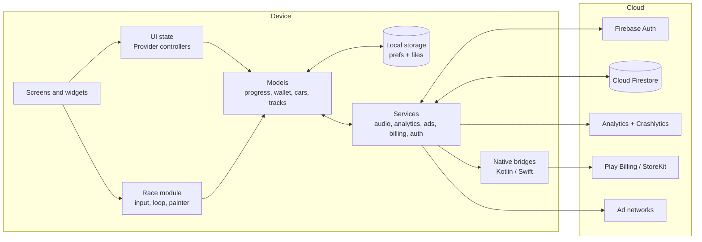
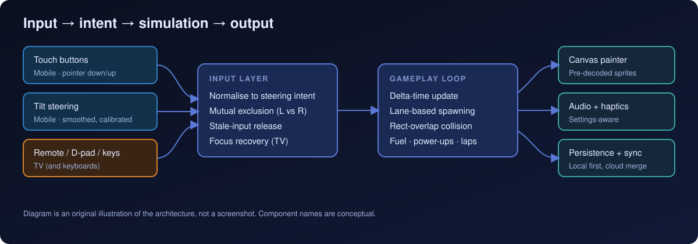
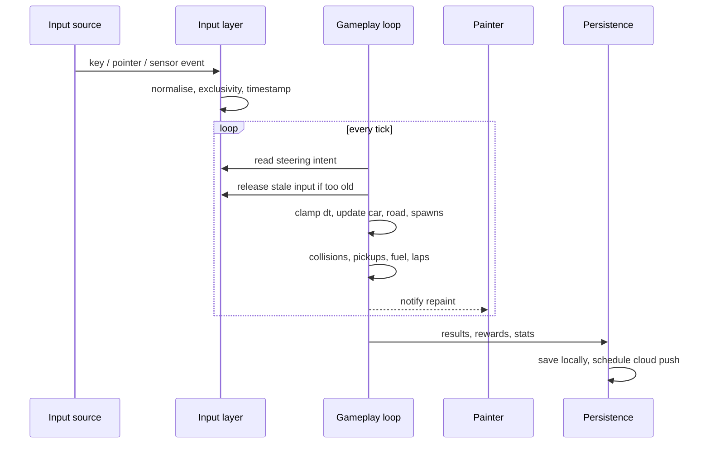
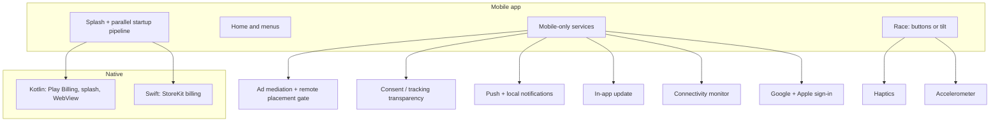
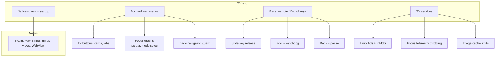
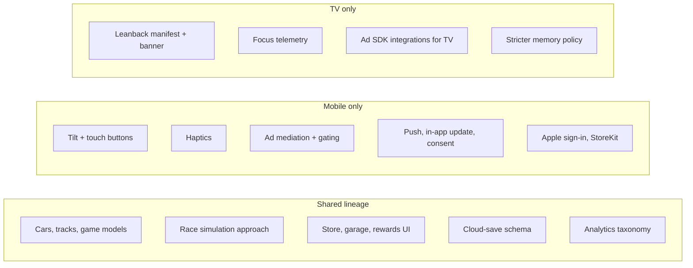
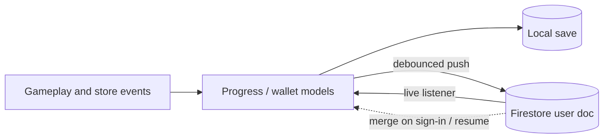

# Architecture

All diagrams below are original and conceptual. Component names describe responsibilities; they are not the names of production classes or files.

## 1. High-level system architecture



Responsibilities:

- **Screens and widgets** render menus, store, garage and dialogs. Heavy screens scope rebuilds with `Selector`.
- **Race module** owns the gameplay simulation and the canvas painter.
- **Models** hold player progress, wallet, catalogs (cars, tracks) and cloud-save documents; they are the source of truth the services read and write.
- **Services** are singletons that wrap external concerns. The game loop does not call SDKs directly.
- **Native bridges** exist for billing (and for ad platform views on TV).

## 2. Gameplay and input flow

<p align="center">
  
</p>

The sequence below shows the same flow over time.



## 3. Mobile architecture



## 4. Android TV architecture



## 5. Shared vs platform-specific



## Startup pipeline

Both apps launch through a lightweight splash app that renders the first frame immediately, then runs initialisation in parallel (Firebase, audio, asset preload for the home screen). Mobile additionally gates the app-open ad on confirmed remote config and connectivity, with a timeout so launch is never blocked on an ad. Only after this does the main app mount.

## Data and sync



The cloud document carries a schema version, wallet, progress, purchases, settings and a capped race history. Merge rules combine local and cloud data rather than overwriting one with the other.

## Conceptual project layout

A sanitised view of how the code is organised, not the real directory tree:

```text
app
├── entry & startup pipeline     # splash, parallel init, deferred services
├── screens                      # home, modes, garage, tracks, race, store, settings, records
├── race                         # input handling, simulation, painter, overlays
├── models                       # cars, tracks, progress, wallet, cloud save
├── services                     # auth, cloud save, billing, ads, analytics, audio, config
├── widgets                      # shared UI, dialogs, TV focus widgets
└── platform                     # Android (Kotlin) and iOS (Swift) bridges, benchmark modules
```
