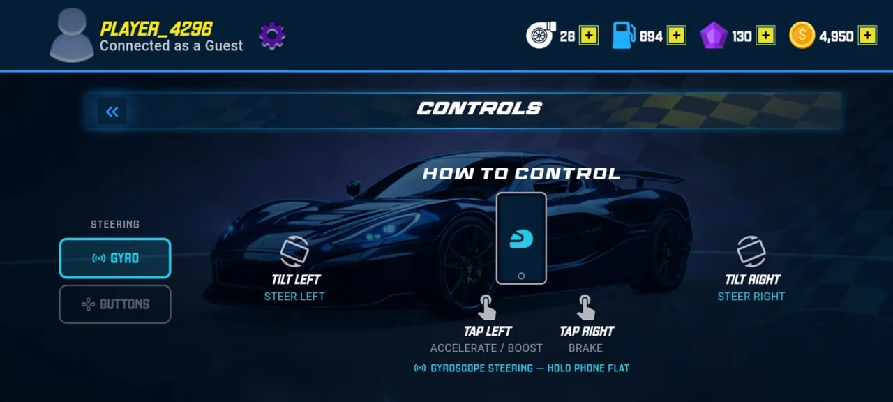
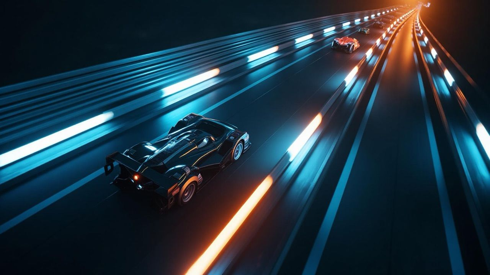

# Mobile vs Android TV

2D Turbo Racing ships as two applications. This document compares them using what is observable in the production projects. Where the evidence is circumstantial, the wording says so.

## Relationship between the two apps

The apps are separate Flutter projects with the same game design, catalogs and a large overlap in UI code. Roughly half of the files that exist in both differ in content, mostly in services, ad integration and race input. Mobile has a set of services and screens TV does not (consent, push, in-app update, connectivity, ad mediation and auditing), and TV has a small set Mobile does not (focus telemetry, ad SDK wrappers). The Mobile project still contains TV-style focus widgets and key handling, which suggests the two share a lineage; this document does not claim which came first.

<table>
  <tr>
    <td align="center"> <b>Mobile</b>: in-app Controls screen with Gyro and Buttons steering modes (real screenshot)</td>
    <td align="center"> <b>Android TV</b>: launcher banner artwork shipped with the TV app (artwork, not a screenshot)</td>
  </tr>
</table>

## Comparison

| Dimension | Mobile | Android TV |
|---|---|---|
| Platforms | Android, iOS | Android TV |
| Manifest posture | Touchscreen required, Leanback not required | Leanback required, touchscreen not required, TV launcher entry and banner |
| Orientation | Landscape, either direction (sensor-based) | Landscape |
| Steering | On-screen buttons (default) or tilt | Remote left/right (A/D also handled) |
| Activate nitro | Tap the on-screen boost card, or keys | OK / Select / Up |
| Activate shield | Key-based (Down / S) in the verified code | Down |
| Back | System back pauses the race (also an on-screen pause tap target) | Back key pauses the race |
| Menu navigation | Touch; focus support retained | D-pad focus traversal with custom focus graphs |
| Focus visuals | Standard | Custom TV widgets with explicit focus states, no ripple |
| UI scaling | 1080p baseline, scale clamped to a minimum so phones stay readable | 1080p baseline |
| Haptics | Yes, user toggle | No |
| Sensors | Accelerometer (tilt) | No |
| Accounts | Google and Apple sign-in | Google sign-in |
| Cloud save | Yes | Yes |
| Billing | Play Billing (Android) and StoreKit (iOS) bridges | Play Billing bridge |
| Ads | Mediation layer with remote placement toggles, request throttling and audit trail | Unity Ads plugin and InMobi native SDK integration |
| Notifications | Push and local notifications | None observed |
| Updates | In-app update flow | None observed |
| Consent | Consent / tracking-transparency flow | None observed |
| Memory posture | Image cache capped, trimmed before heavy screens | Same cache policy, specifically justified in code by TV heap limits |
| Release tooling | R8, ABI filtering, baseline profile, macrobenchmarks | Same |
| Tests | Ads gating, analytics validation, progress merge | Analytics validation, TV focus telemetry |

## Interaction differences

### Mobile
The race screen offers a button-steering mode where each button reports pointer down, up and cancel, so a finger sliding off a button cannot leave steering stuck. In tilt mode the game reads the accelerometer, corrects the axis when the user flips between the two landscape orientations, recalibrates the neutral point from an averaged sample, and applies smoothing and a dead zone. A settings slider scales both modes.

### Android TV
Everything must be reachable by D-pad. The race screen listens to raw key events on a dedicated focus node. Because remote key-up events can be missed, each press stamps a time, and steering is released by a timer and by a per-frame stale check. Pressing left cancels right and vice versa; if both are somehow active, both are cleared. A watchdog checks several times per second that the game still owns focus and requests it back if a dialog or overlay stole it.

## UI and screen differences

- TV targets a 10-foot viewing distance, so the UI is scaled from a fixed 1080p design size rather than from device density alone.
- Mobile adds a minimum scale floor so text and buttons stay legible on small landscape screens.
- TV widgets (buttons, cards, tabs) implement their own focus appearance; Mobile screens additionally use selection and swipe patterns suited to touch.

## Navigation differences

TV has dedicated utilities for a D-pad order across the top bar (profile, settings, resources) and across mode-select content, and a guard so that one Back press does not close both a nested screen and the root screen. Mobile relies on touch navigation and the standard back gesture while keeping parts of that focus machinery.

## Performance considerations

Both builds disable Impeller and Vulkan in their manifests and use R8 shrinking. The TV build applies a tight image-cache budget with a code comment citing out-of-memory behaviour on TV heaps, and the same policy is present on Mobile. TV's manifest also disables app-level hardware acceleration while keeping it on for the WebView activity; the reason is not documented, so no claim is made about its effect.

## Code reuse and platform-specific implementation

**Reused concepts:** car and track catalogs, models, progress and wallet logic, reward appliers, store and garage UI structure, analytics taxonomy, race simulation approach.

**Platform-specific:** input handling in the race screen, ad stack, manifests, native billing wrappers, notification and update services (Mobile), focus telemetry (TV).

## Honest trade-off

Keeping two near-duplicate codebases made it easy to diverge per platform, but it multiplies maintenance: any fix to shared logic must be applied twice. A shared package for models, services and simulation, with thin per-platform shells, would be the natural next step (see the [case study](TECHNICAL_CASE_STUDY.md#future-technical-improvements)).
