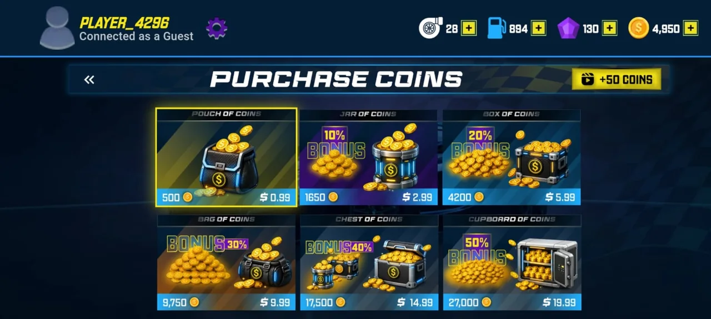

# Product Overview

All screenshots on this page are real captures from the Mobile build, taken with a guest account.

## What it is

2D Turbo Racing is a top-down 2D racing game played in landscape. The road scrolls vertically; the player moves the car across lanes, avoiding obstacles and traffic and collecting pickups, until the track's lap distance is complete or the car crashes.

It is delivered as two apps built from one design: a **Mobile app** (Android and iOS) controlled with on-screen buttons or by tilting the device, and an **Android TV app** controlled with a remote or key events. The game is single-player.

## Core loop

1. Pick a mode from the main menu.
2. Choose a car and a track (locked items unlock with coins, gems or purchases).
3. Confirm a free-play session, including the traffic level.
4. Race: steer, dodge, collect coins, gems and power-ups, watch fuel.
5. Finish or crash. Earn coins (scaled by track difficulty), optionally double the reward with a rewarded ad.
6. Spend coins and gems in the garage and store, claim daily rewards, repeat.

<table>
  <tr>
    <td align="center"> Main menu: Play Now, Garage, Store, Daily Rewards, limited-time offer</td>
    <td align="center"> Game modes</td>
  </tr>
  <tr>
    <td align="center"> Step 1 of 2: choose a car</td>
    <td align="center"> Step 2 of 2: choose a track</td>
  </tr>
  <tr>
    <td align="center"> Free play setup with traffic level</td>
    <td align="center"> Racing on Sunset Beach</td>
  </tr>
</table>

## Mechanics

| Mechanic | Behaviour (high level) |
|---|---|
| Steering | Lateral movement with friction; input method depends on platform and settings |
| Car stats | Each car has speed, acceleration and handling values that shape road speed and lateral response |
| Track difficulty | Four tiers (Easy, Medium, Hard, Expert); higher tiers scale road speed and coin rewards |
| Laps | Tracks define 3 to 5 laps; distance converts to a lap counter and a finish |
| Obstacles | Cones and barriers with per-theme art; optional traffic cars |
| Pickups | Coins, gems, nitro, shield, magnet |
| Power-ups | Nitro (speed boost), shield (absorbs a hit), magnet (collects nearby coins); stored nitro and shield can be bought and activated in a race |
| Fuel | Drains while driving; running out opens a refill flow (coins or rewarded ad) |
| Crashes | Opens a repair flow (coins or rewarded ad) with per-race limits |
| Traffic | A free-play traffic level selector controls how busy the road is |

## Content

- **10 tracks**: Sunset Beach, Country Side Rally, Desert Storm, Rainy Night, Autumn Valley, Mountain Pass, Jungle Rush, Frozen Tundra, Underwater Tunnel and Volcano Fury. The first two are free; the rest unlock with coins (or gems where offered) or through purchases.
- **14 cars** across four rarity tiers (Common, Rare, Epic, Legendary), each with speed, acceleration and handling stats.
- **Modes**: *Drive with Traffic* is playable; *Race with Opponents* is shown as coming soon.

## Progression and economy

- **Coins** are earned by driving and collecting; spent on cars, tracks, repairs and refuels.
- **Gems** are the premium currency.
- **Daily rewards** follow a 7-day streak that resets after a missed day.
- **Limited-time offers and bundles** come from a remote catalog with countdown timers.
- **Accounts**: the UI shows a guest state; signing in enables cloud-synced progress.

<table>
  <tr>
    <td align="center"> Turbo Store</td>
    <td align="center"> Coin packs</td>
  </tr>
</table>

## Settings and extras

Settings are grouped in a hub: gameplay settings (volume, music, steering mode, sensitivity, vibration, race difficulty), profile, records and achievements, extras, and a How to Play screen. Privacy hub and policy screens are included.

<table>
  <tr>
    <td align="center"> Settings hub</td>
    <td align="center"> Controls: gyro or buttons</td>
  </tr>
</table>

## What makes it technically interesting

- One game design delivered to touch/tilt and to remote-control environments
- A custom canvas renderer rather than an off-the-shelf engine
- Input reliability work for TV remotes
- A local-first cloud save with merge logic
- Monetisation plumbing (billing, ads, remote gating) kept at the edge of the game loop

Continue with the [technical case study](TECHNICAL_CASE_STUDY.md).
